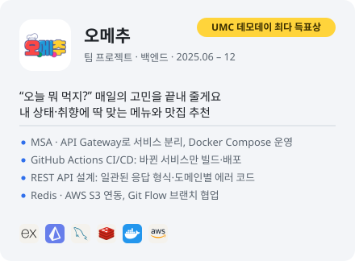
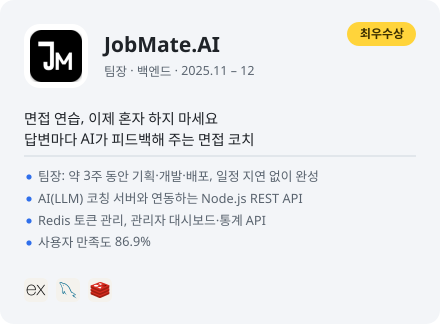
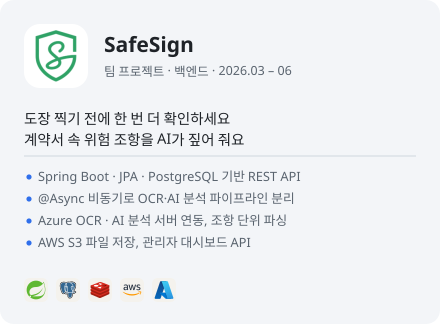
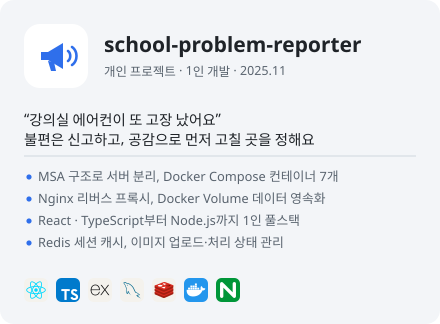
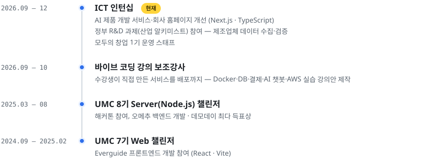
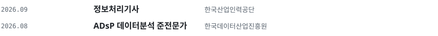

<picture><source media="(prefers-color-scheme: dark)" srcset="assets/head-dark.svg"></picture>

  

### 대표 프로젝트

<a href="https://github.com/Team-Omechu/Omechu-server"><picture><source media="(prefers-color-scheme: dark)" srcset="assets/card-omechu-dark.svg"></picture></a>
<a href="https://github.com/JobMate-team/jobmate-backend"><picture><source media="(prefers-color-scheme: dark)" srcset="assets/card-jobmate-dark.svg"></picture></a>
<a href="https://github.com/SafeSignProject/safeSign-backend/tree/dev"><picture><source media="(prefers-color-scheme: dark)" srcset="assets/card-safesign-dark.svg"></picture></a>
<a href="https://github.com/3tjwls7/school-problem-reporter"><picture><source media="(prefers-color-scheme: dark)" srcset="assets/card-school-dark.svg"></picture></a>

### 경험

<picture><source media="(prefers-color-scheme: dark)" srcset="assets/timeline-dark.svg"></picture>

### 자격증

<picture><source media="(prefers-color-scheme: dark)" srcset="assets/certs-dark.svg"></picture>

### Stack

<picture>
  <source media="(prefers-color-scheme: dark)" srcset="https://skillicons.dev/icons?i=ts,js,react,nextjs,nodejs,express,spring,prisma,mysql,postgres,redis,supabase,docker,aws,nginx,vercel,git,github,swagger&amp;theme=dark&amp;perline=10">
  
</picture>

**AI Tools**

### 잔디

<picture><source media="(prefers-color-scheme: dark)" srcset="assets/grass-span-dark.svg"></picture>

Contact · <a href="mailto:seojin53185318@gmail.com">seojin53185318@gmail.com</a>

<picture><source media="(prefers-color-scheme: dark)" srcset="assets/foot-dark.svg"></picture>
